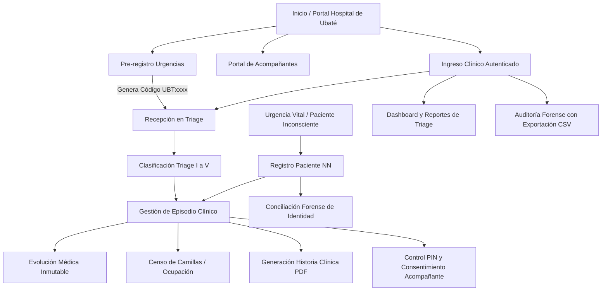

# INFORME TÉCNICO DE IMPLEMENTACIÓN Y AUDITORÍA DE SEGURIDAD
## Sistema de Gestión Hospitalaria y Urgencias — Hospital de Ubaté

---

## 1. Resumen Ejecutivo

El presente documento consolida la arquitectura, funcionalidades asistenciales y mecanismos de seguridad desarrollados para el sistema de atención médica y gestión de urgencias del **Hospital de Ubaté**. 

El sistema fue concebido bajo el paradigma de **Seguridad desde el Diseño (Security by Design)** y **Privacidad por Defecto (Privacy by Default)**, dando estricto cumplimiento al marco regulatorio colombiano de salud y protección de la información:

* **Resolución 1995 de 1999 (Ministerio de Salud):** Normas para el manejo, diligenciamiento, custodia, inmutabilidad y reserva legal de la Historia Clínica electrónica.
* **Resolución 5596 de 2015 (Ministerio de Salud):** Sistema de selección y clasificación de pacientes en servicios de urgencias (**Triage I al V**) según severidad y riesgo vital.
* **Ley Estatutaria 1581 de 2012 (Habeas Data):** Protección integral de datos personales sensibles de salud, gestión explícita de consentimiento informado y aplicación de la excepción del **Artículo 10** (urgencia vital en pacientes inconscientes o desorientados).

### Métricas de Calidad y Confiabilidad
* **Batería de Pruebas Automatizadas:** 155 pruebas ejecutadas, 674 aserciones, **0 fallos** (`php artisan test`).
* **Estándares de Código:** 100% de cumplimiento con Laravel Pint (PSR-12 estricto).
* **Auditoría de Vulnerabilidades:** 0 vulnerabilidades conocidas en dependencias PHP (`composer audit`) y JavaScript (`npm audit`).

---

## 2. Herramientas y Tecnologías de Ingeniería

| Herramienta / Tecnología | Versión / Tipo | Propósito en el Proyecto |
| :--- | :--- | :--- |
| **Laravel** | 12.x (PHP 8.2+) | Framework backend con arquitectura MVC, ORM Eloquent y middleware de seguridad. |
| **PostgreSQL / MySQL** | Relacional | Motor de persistencia transaccional con bloqueos de concurrencia (`lockForUpdate`). |
| **Spatie Laravel Permission** | RBAC | Control de acceso basado en roles (`medico`, `enfermero`, `coordinador`, `admisiones`, `auditor`, `administrador`). |
| **Dompdf** | 3.1+ | Generación forense de historias clínicas en PDF sin ejecución de código PHP (`enable_php: false`). |
| **Pragmarx Google2FA** | TOTP RFC 6238 | Autenticación de Dos Factores obligatoria para personal clínico asistencial. |
| **Bcrypt** | Cost Factor 12 | Hash robusto e irreversible para contraseñas de usuarios. |
| **AES-256-CBC** | Criptografía Simétrica | Cifrado en reposo para nombres, diagnósticos, PINs y antecedentes en base de datos. |
| **HMAC-SHA256** | Blind Index | Índices ciegos con sal secreta para búsquedas rápidas por documento sin descifrar masivamente. |
| **Bootstrap 5 + Sass** | Frontend Local | Sistema de diseño accesible compilado localmente con Vite, sin dependencias CDN externas. |
| **Bootstrap Icons** | Iconografía Vectorial | Iconos lineales profesionales (`bi bi-*`), eliminando emojis decorativos. |
| **PHPUnit** | Test Runner | Automatización de pruebas unitarias, de integración, de autorización y de estrés de seguridad. |
| **Laravel Pint** | Linter / Formatter | Estandarización de estilo de código limpio y mantenible. |

---

## 3. Módulos Desarrollados y Funcionalidades Asistenciales

### 3.1. Pre-registro Digital de Urgencias (`/preregistro`)
* **Propósito:** Permitir al paciente o familiar registrar datos demográficos y antecedentes antes de llegar a la institución para agilizar la admisión.
* **Funcionalidades:**
  * Generación de código público de alta entropía (8 caracteres alfanuméricos en mayúsculas, ej: `UBT8K9P2`).
  * Evaluación interactiva de signos de alarma médica que advierten acudir de inmediato o llamar a la línea de ambulancias.
  * Trampa Honeypot (`hospital_contact_time`) para desviar bots maliciosos sin procesar registros fraudulentos.
  * Tarea programada (`preregistration:expire`) para expirar solicitudes no concretadas en 24 horas.

### 3.2. Clasificación de Triage y Episodios Clínicos (`/episodios`)
* **Propósito:** Gestión integral del paciente en urgencias conforme a la **Resolución 5596 de 2015**.
* **Funcionalidades:**
  * Categorización por severidad: Triage I (Reanimación, 0 min), Triage II (Emergencia, 30 min), Triage III (Urgencia, 120 min), Triage IV (Prioritaria) y Triage V (No urgente).
  * Estados del ciclo de vida: `preregistrado`, `en_espera`, `en_valoracion`, `ingresado`, `egresado`, `cancelado`.
  * Pestañas de alta densidad informativa: *Mis Pacientes*, *Todos los Activos*, *En Espera*, *Pre-registros* y *Egresados*.
  * Admisión directa de pre-registros mediante un clic por parte del personal de enfermería o médico de triage.

### 3.3. Pacientes No Identificados (NN) y Conciliación Forense
* **Propósito:** Atención de pacientes inconscientes, indocumentados o en estado crítico respetando la excepción del Art. 10 de la Ley 1581 de 2012.
* **Funcionalidades:**
  * Admisión inmediata asignando un identificador secuencial formal: `NN-AAAAMMDD-XXXX` (ej. `NN-20261026-0001`).
  * Módulo de Conciliación de Identidad (`/episodios/{episode}/conciliar`): Unificación con la cédula del paciente una vez sea identificado por familiares o Registraduría.
  * **Preservación de Trazabilidad Forense:** El registro NN original nunca se borra ni se sobreescribe; se enlaza formalmente en la historia clínica conservando el histórico legal para peritajes judiciales.
  * Exigencia de justificación y soporte documental mínimo de 10 caracteres.

### 3.4. Historia Clínica Electrónica y Protocolo Break-Glass
* **Propósito:** Diligenciamiento de evoluciones médicas, signos vitales, órdenes y procedimientos con reserva legal (Res. 1995/1999).
* **Funcionalidades:**
  * **Inmutabilidad Médica:** Prohibición estricta de modificación (`update`) o borrado (`delete`) de evoluciones registradas; solo se admiten notas de aclaración o anulación enlazadas cronológicamente.
  * **Diferenciación de Responsabilidad:** El médico tratante principal es obligatorio e intransferible sin reemplazo formal; el personal de apoyo puede ser asignado y finalizado puntualmente una vez completada su interconsulta.
  * **Protocolo Break-Glass:** Mecanismo de acceso excepcional que permite a un médico no asignado consultar una historia clínica ante una emergencia vital, exigiendo un motivo clínico que queda registrado irrevocablemente en la auditoría forense.

### 3.5. Generación de Historia Clínica en PDF Oficial
* **Propósito:** Emisión de certificados e historias clínicas completas para remisiones o requerimientos judiciales.
* **Funcionalidades:**
  * Encabezado legal institucional del Hospital de Ubaté, datos del paciente, resumen de triage, diagnósticos y evoluciones.
  * Marca de agua forense diagonal en todas las páginas (*"COPIA ASISTENCIAL CONTROLADA"*).
  * Numeración legal continua ("Página X de Y").
  * Configuración segura en Dompdf con ejecución de PHP desactivada (`enable_php: false`).
  * Auditoría automática de cada descarga con IP y usuario responsable.

### 3.6. Censo Hospitalario, Habitaciones y Camillas (`/ocupacion`)
* **Propósito:** Control visual y operacional de la capacidad instalada en urgencias.
* **Funcionalidades:**
  * Estructura jerárquica: Sedes $\to$ Pisos $\to$ Áreas $\to$ Habitaciones $\to$ Camillas.
  * Estados de camilla: `disponible`, `ocupada`, `mantenimiento`, `limpieza`, `fuera_de_servicio`.
  * Reglas de integridad: Bloqueo de eliminación de camillas ocupadas y cascada automática de mantenimiento al inhabilitar una habitación.

### 3.7. Personal Asistencial y Programación de Turnos (`/personal`)
* **Propósito:** Administración de profesionales de la salud, turnos y balance de carga asistencial.
* **Funcionalidades:**
  * Perfil asistencial con código médico institucional (`MED-XXXXXX`), registro profesional y especialidad.
  * Turnos rotativos, fijos y nocturnos con validación de solapamiento y cálculo de turno activo.
  * Contador dinámico de pacientes asignados por profesional.

### 3.8. Portal Público de Seguimiento para Acompañantes (`/acompanante`)
* **Propósito:** Canal oficial para que los familiares consulten en tiempo real el estado de atención del paciente sin ingresar a áreas restringidas de urgencias.
* **Funcionalidades:**
  * Acceso seguro mediante código público del paciente (`UBTxxxx`) + PIN numérico.
  * **Definición del PIN:** Por defecto corresponde a los **últimos 4 dígitos del documento** del paciente; adicionalmente el personal médico puede emitir o regenerar un PIN de 6 dígitos entregado presencialmente.
  * **Cifrado en Base de Datos:** El PIN se almacena cifrado (`AES-256`) junto con su hash, lo que permite al médico tratante y al administrador consultarlo en la pantalla del episodio para informárselo al familiar.
  * **Control de Consentimiento del Paciente:** El paciente puede autorizar o revocar en cualquier momento que se compartan sus diagnósticos y procedimientos con el familiar.
  * **Aislamiento en Navbar:** El enlace de acompañantes está visible únicamente para visitantes no autenticados (`@guest`), evitando colisiones de sesión en terminales médicas.

### 3.9. Reportes de Gestión, Métricas de Triage y Auditoría (`/reportes` y `/auditoria`)
* **Propósito:** Inteligencia asistencial, control de calidad y trazabilidad médico-legal.
* **Funcionalidades:**
  * Cálculo dinámico de tiempos reales de espera por nivel de triage (desde `triage_at` hasta la primera evolución médica `performed_at`).
  * Porcentaje de cumplimiento normativo institucional frente a los estándares de la Resolución 5596.
  * Tasa de ocupación de camas por área asistencial.
  * Bitácora de auditoría multi-filtro con exportación en formato CSV estructurado con cabecera UTF-8 BOM para apertura directa en Excel.

---

## 4. Matriz de Pruebas de Seguridad: Implementación, Hallazgos y Correcciones

Esta sección detalla de forma simplificada cada prueba de seguridad ejecutada, el problema detectado, la corrección aplicada y cómo explicarlo en una sustentación técnica:

### 4.1. Falsificación de Petición en Sitios Cruzados (CSRF)
* **¿Qué es?:** Ataque donde un sitio externo engaña al navegador del médico para ejecutar acciones no deseadas en el sistema.
* **Cómo se probó:** Se enviaron peticiones `POST` a endpoints críticos sin token o con tokens alterados.
* **Problema detectado:** En pruebas automatizadas con PHPUnit, Laravel omite por defecto la verificación de CSRF (`runningUnitTests() = true`).
* **Cómo se corrigió:** Se sobreescribió localmente el middleware `ValidateCsrfToken` forzando la validación en el test unitario. El sistema rechaza inmediatamente peticiones inválidas con código de error **`419 Page Expired`**.
* **Cómo explicarlo:** *"Garantizamos que cualquier formulario o acción médica solo pueda enviarse desde las páginas legítimas de nuestra aplicación, bloqueando cualquier intento de manipulación externa con código 419."*

### 4.2. Prevención de Ataques de Fuerza Bruta y DoS (Rate Limiting)
* **¿Qué es?:** Envío masivo de miles de solicitudes por segundo para adivinar contraseñas, PINs o saturar el servidor.
* **Cómo se probó:** Se ejecutaron bucles automáticos de peticiones rápidas contra `/login`, `/contacto`, `/preregistro` y `/acompanante`.
* **Cómo se implementó:** Middlewares de limitación por IP y tiempo (`throttle:5,1`, `throttle:10,1`, `throttle:login`).
* **Resultado:** Al superar el umbral permitido, el servidor bloquea al atacante respondiendo **`429 Too Many Requests`**.
* **Cómo explicarlo:** *"Si un usuario o un bot intenta probar contraseñas o enviar formularios repetidamente, el sistema lo bloquea automáticamente a los pocos intentos con un error 429."*

### 4.3. Control de Acceso y Mitigación IDOR (Insecure Direct Object Reference)
* **¿Qué es?:** Cuando un usuario cambia el ID en la URL para ver o modificar información que no le pertenece (ej. un médico intentando dar de alta a un paciente asignado a otro médico).
* **Cómo se probó:** Se crearon dos médicos (`Doctor A` y `Doctor B`). El `Doctor B` intentó dar de alta y prescribir sobre el paciente del `Doctor A`. Además, un usuario con rol enfermero intentó modificar la infraestructura de camas.
* **Cómo se corrigió:** Políticas de autorización estrictas (`EmergencyEpisodePolicy`, `can('episodios.dar_alta')`) y validación de propiedad en el controlador. El servidor responde **`403 Forbidden`**.
* **Cómo explicarlo:** *"Cada acción clínica verifica que el profesional esté legalmente asignado al paciente. Si alguien intenta manipular la URL, el sistema le deniega el acceso con error 403."*

### 4.4. Protección de Caché en Terminales Compartidas (`Cache-Control: no-store`)
* **¿Qué es?:** En un hospital, varios médicos usan el mismo computador en el turno. Si un médico cierra sesión y el siguiente presiona el botón "Atrás" del navegador, podría ver la historia clínica del paciente anterior almacenada en la memoria caché.
* **Cómo se probó:** Inspección de las cabeceras HTTP en todas las rutas autenticadas.
* **Cómo se corrigió:** El middleware `SecurityHeaders` inyecta automáticamente para todo usuario autenticado:
  `Cache-Control: no-store, no-cache, must-revalidate, max-age=0` y `Pragma: no-cache`.
* **Cómo explicarlo:** *"Obligamos a que el navegador nunca guarde en memoria las pantallas de historias clínicas; al cerrar sesión o retroceder, el navegador exige autenticarse nuevamente."*

### 4.5. Anti-Enumeración de Pacientes y Sanitización de Rutas
* **¿Qué es?:** Escaneo automatizado de números de documento o códigos para descubrir quién está hospitalizado.
* **Cómo se probó:** Se enviaron solicitudes con códigos inexistentes, códigos válidos con PIN incorrecto y caracteres especiales en los parámetros de ruta.
* **Cómo se corrigió:** 
  1. Respuestas de error idénticas: el sistema responde el mismo mensaje genérico (*"Credenciales de acceso no válidas"*) en el mismo tiempo promedio.
  2. Restricciones estrictas en rutas: `whereUuid('episode')`, `whereNumber('room')`, `whereAlphaNumeric('code')`. Peticiones con formatos maliciosos son rechazadas de inmediato con **`404 Not Found`**.
* **Cómo explicarlo:** *"El sistema no le da pistas a un atacante sobre si un paciente existe o no; ante cualquier falla de código o PIN, la respuesta es idéntica y no permite adivinación."*

### 4.6. Cifrado en Reposo de Datos Sensibles (Ley 1581 de 2012)
* **¿Qué es?:** Si alguien roba una copia de seguridad de la base de datos, no debe poder leer la información confidencial de los pacientes.
* **Cómo se probó:** Se realizó una consulta directa SQL (`DB::table('patients')`, `DB::table('companions')`) sin pasar por Eloquent.
* **Cómo se corrigió:** Los nombres, diagnósticos, PINs y antecedentes utilizan el cast `encrypted` de Laravel (cifrado simétrico AES-256-CBC). En la base de datos solo se observan cadenas cifradas ilegibles. Para las búsquedas por cédula se implementó un índice ciego hash HMAC-SHA256.
* **Cómo explicarlo:** *"Los datos de salud y nombres están protegidos con cifrado militar en la base de datos. Si la base de datos es extraída, los datos son ilegibles sin la clave criptográfica del servidor."*

### 4.7. Inmutabilidad y Trazabilidad de Historias Clínicas (Res. 1995/1999)
* **¿Qué es?:** La ley prohíbe borrar, tachar o modificar evoluciones y registros clínicos ya firmados.
* **Cómo se probó:** Intentos directos en código de ejecutar `$clinicalEntry->delete()` y `$clinicalEntry->update()`.
* **Cómo se corrigió:** Interceptores en el modelo Eloquent (`booted`) lanzan excepciones inmediatas ante cualquier intento de alteración, garantizando inmutabilidad.
* **Cómo explicarlo:** *"Una nota médica guardada no puede ser editada ni eliminada por nadie, ni siquiera por el administrador, garantizando plena validez jurídica."*

---

## 5. Diseño Frontend, Accesibilidad y Buenas Prácticas

1. **Accesibilidad WCAG 2.2 AA:**
   * Contraste cromático verificado superior a 4.5:1 en todos los componentes.
   * Foco visual accesible (`outline: 2px solid #0d5c9c`) para navegación por teclado.
   * Objetivos táctiles mínimos de **44px** en botones e interactivos para dispositivos móviles.
2. **Diseño Adaptativo (Responsive):**
   * Verificado en pantallas móviles ($\le 576\text{px}$), tablets / iPad ($768\text{px} - 1024\text{px}$) y estaciones de trabajo / Mac ($\ge 1200\text{px}$).
   * Barra de navegación y listas clínicas colapsables con scroll horizontal protegido.
3. **Ergonomía Visual y Unificación de Componentes:**
   * **Cero Emojis (Verificación Automatizada):** Escaneo de código fuente certificando **0 emojis** en `app/`, `resources/` (vistas, estilos Sass, scripts JS) y `routes/`. Todos los elementos visuales son iconos vectoriales Bootstrap Icons (`bi bi-*`).
   * **Consistencia de Botones:** Los botones de `Ingresar` y `Cerrar sesión` comparten exactamente la misma jerarquía visual (`btn btn-primary btn-sm px-3 py-1`) con sus respectivos iconos de acceso (`bi-box-arrow-in-right`) y salida (`bi-box-arrow-right`).
   * **Separación de Roles en Navegación:** Los módulos públicos de contacto ciudadano (`/contacto`) y seguimiento de acompañantes (`/acompanante`) están estrictamente encapsulados para visitantes no autenticados (`@guest`). Para médicos y administradores, la barra se mantiene limpia, focalizada en la operación clínica y asistencial.
   * **Redirección Predictiva al Dashboard:** La ruta `/admin` y el flujo de autenticación post-login / 2FA conducen directa e inequívocamente al **Dashboard** institucional, previniendo aterrizajes residuales en auditoría u otras vistas secundarias.
4. **Seguridad en Renderizado (CSP):**
   * Ausencia total de scripts inline o manejadores `onclick` en las plantillas Blade.
   * Variables sanitizadas y escapadas por defecto contra ataques XSS.
5. **Acceso Dual a la Documentación (Consola y Web):**
   * **Vía Consola (Artisan):** Ejecutable mediante `php artisan hospital:docs` (con opciones `--seguridad` y `--modulos`) para consultar el informe técnico directamente en la terminal con tablas y colores de consola.
   * **Vía Web:** Accesible mediante la ruta `/documentacion` (o `/docs`), renderizando este informe en HTML accesible bajo los estándares del hospital.

---

## 6. Conclusiones y Preparación para Fase 8

El sistema del **Hospital de Ubaté** cuenta con una base arquitectónica robusta, modular y blindada contra las principales amenazas del **OWASP Top 10**. 

Cumple con suficiencia técnica y legal los requerimientos de la normatividad sanitaria colombiana y se encuentra listo para iniciar la **Fase 8: Preparación de Producción, Auditoría de Configuración y Documentación de Despliegue**.

