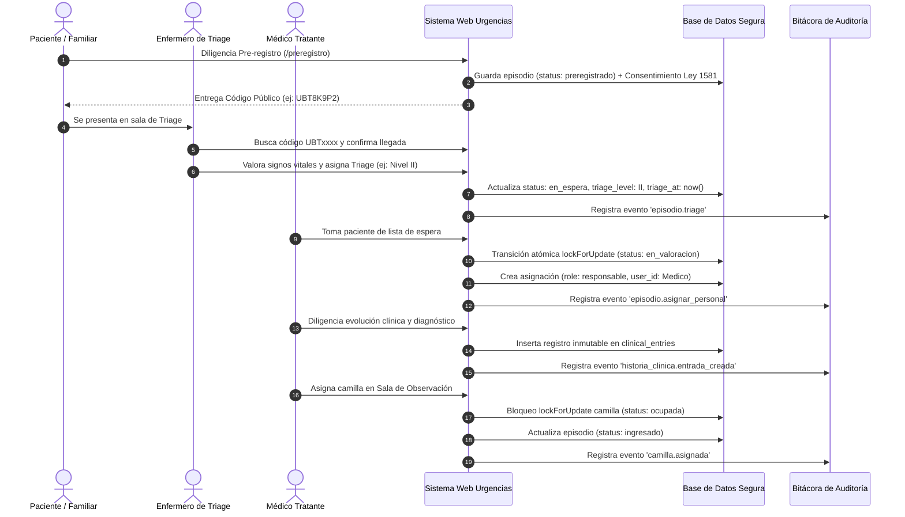
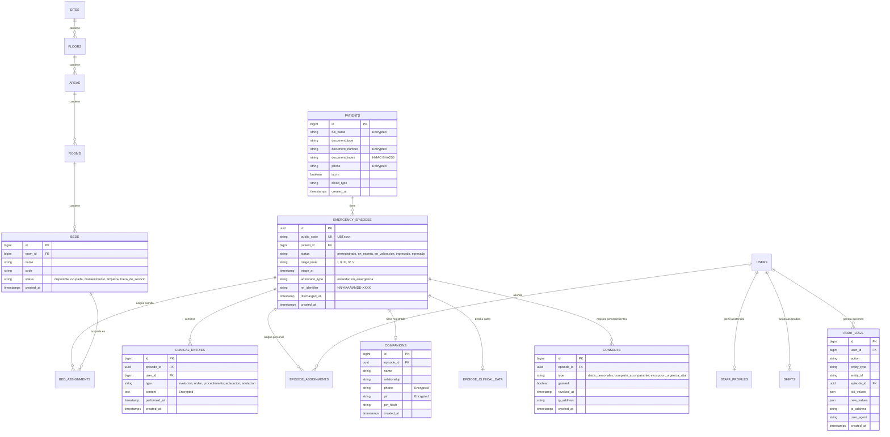

# Arquitectura del Sistema de Información
## Sistema de Gestión Hospitalaria y Urgencias — Hospital de Ubaté

---

## 1. Visión General de la Arquitectura

El sistema de urgencias del **Hospital de Ubaté** está diseñado sobre un modelo de **Arquitectura en Capas Limpias (Clean Layered Architecture)** dentro del framework **Laravel 12 (PHP 8.2+)**. 

Su propósito es desacoplar de forma estricta las reglas de negocio médico, las políticas de seguridad y la persistencia de datos, garantizando alta mantenibilidad, trazabilidad y rendimiento en condiciones de alta concurrencia.

---

## 2. Capas de la Aplicación

```mermaid
graph TD
    subgraph Capa_Presentacion [Capa de Presentación]
        UI[Blade Views + Bootstrap 5 + Sass + Bootstrap Icons]
        Vite[Compilación Local Vite - Sin CDN Externos]
    end

    subgraph Capa_Enrutamiento [Capa de Enrutamiento y Middlewares]
        Routes[Web Routes con Restricciones Regex whereUuid / whereNumber]
        SecHeaders[SecurityHeaders: CSP, HSTS, Cache-Control no-store]
        AuthMid[Auth + EnsureUserIsActive + RequireTwoFactor]
        Throttle[RateLimiter: 5/min, 10/min, login]
    end

    subgraph Capa_Controladores [Capa de Controladores y FormRequests]
        Requests[FormRequests: Validación estricta, tipos, longitudes]
        Policies[Policies: EmergencyEpisodePolicy, ResourcePolicy, Gates]
        Controllers[Controladores Especializados por Dominio Asistencial]
    end

    subgraph Capa_Servicios [Capa de Servicios de Negocio y Seguridad]
        SvcPrereg[PreregistrationService]
        SvcComp[CompanionService]
        SvcMetrics[EmergencyMetricsService]
        SvcPdf[PdfReportService - Dompdf Engine]
        SvcAudit[Audit Service - Inmutable Logging]
        SvcCrypto[Encryption & Blind Index HMAC-SHA256]
    end

    subgraph Capa_Datos [Capa de Modelos y Persistencia]
        Eloquent[Modelos Eloquent con Eventos de Inmutabilidad]
        DB[(PostgreSQL / MySQL con Row Locks lockForUpdate)]
    end

    Capa_Presentacion --> Capa_Enrutamiento
    Capa_Enrutamiento --> Capa_Controladores
    Capa_Controladores --> Capa_Servicios
    Capa_Servicios --> Capa_Datos
```

### 2.1. Capa de Presentación
* **Motor:** Blade Templates estructurados con herencia modular (`layouts/app.blade.php`, `partials/navbar.blade.php`, `partials/sidebar.blade.php`).
* **Estilos y Componentes:** Bootstrap 5.3 compilado localmente con Sass mediante Vite.
* **Tokens de Diseño Institucional:** Paleta de colores centralizada en `_tokens.scss` con contrastes WCAG 2.2 AA ($\ge 4.5:1$).
* **Iconografía:** Bootstrap Icons vectoriales (`bi bi-*`). Cero emojis y cero dependencias de servidores CDN externos.

### 2.2. Capa de Enrutamiento y Seguridad de Transporte
* **Filtros de Parámetros:** Todas las rutas aplican validadores de expresión regular en `routes/web.php` (`whereUuid`, `whereNumber`, `whereAlphaNumeric`).
* **Cabeceras HTTP Inyectadas (`SecurityHeaders`):** CSP estricta sin `unsafe-inline`, `X-Frame-Options: DENY`, `X-Content-Type-Options: nosniff`, y `Cache-Control: no-store` para personal autenticado.
* **Control de Tráfico:** Limitadores de tasa (`throttle`) en todos los endpoints públicos expuestos.

### 2.3. Capa de Autorización y Controladores
* **Validación de Entrada:** FormRequests dedicados (`PreregistrationRequest`, `ClinicalEntryRequest`, `StoreUserRequest`, etc.) que aplican validaciones condicionales, límites de caracteres y desinfección antes de que el controlador reciba datos.
* **Políticas de Autorización (ABAC + RBAC):** `EmergencyEpisodePolicy` comprueba la asignación activa del médico al paciente, autorizaciones de acompañante y permisos del usuario.

### 2.4. Capa de Servicios de Dominio
* **`EmergencyMetricsService`:** Cálculo en tiempo real de tiempos de espera en Triage, percentiles y tasas de ocupación hospitalaria.
* **`PdfReportService`:** Renderizado seguro de certificados e historias clínicas con encabezados oficiales y marca de agua forense diagonal.
* **`CompanionService`:** Generación y validación de PINs, evaluación de consentimientos y enmascaramiento de datos personales.
* **`Audit`:** Servicio centralizado de registro de auditoría que captura actor, rol, IP, User-Agent, estado previo y nuevo valor.

### 2.5. Capa de Persistencia y Modelos
* **Eloquent ORM:** Relaciones tipificadas y protección de asignación masiva con `$fillable` explícito.
* **Inmutabilidad:** Métodos `booted()` en modelos clínicos que bloquean en tiempo de ejecución las sentencias `UPDATE` y `DELETE`.
* **Cifrado en Reposo:** Cast `encrypted` transparente para datos confidenciales (nombres, diagnósticos, PINs, teléfonos).

---

## 3. Diagrama de Secuencia: Ciclo de Vida de una Atención de Urgencia

---

## 4. Modelo de Datos Entidad-Relación

