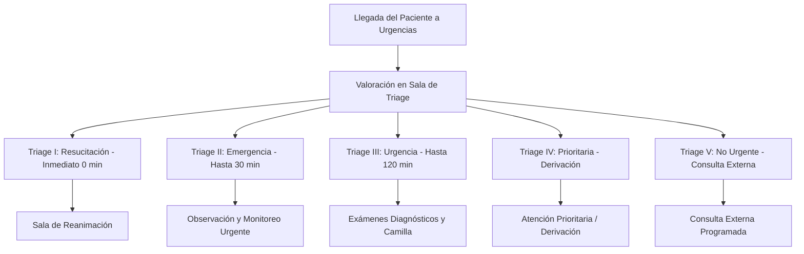

# Marco Normativo y Cumplimiento Legal en Salud
## Sistema de Gestión Hospitalaria y Urgencias — Hospital de Ubaté

---

## 1. Fundamento Constitucional y Legal

El sistema de información hospitalaria y de urgencias del **Hospital de Ubaté** opera en estricta conformidad con el ordenamiento jurídico de la República de Colombia, salvaguardando el derecho fundamental a la salud (Ley Estatutaria 1751 de 2015) y el derecho fundamental al Habeas Data y la intimidad (Artículo 15 de la Constitución Política y Ley Estatutaria 1581 de 2012).

---

## 2. Cumplimiento de la Resolución 1995 de 1999 (Historia Clínica)

La **Resolución 1995 de 1999 del Ministerio de Salud** establece las normas obligatorias para el diligenciamiento, administración, conservación, custodia y confidencialidad de las Historias Clínicas en Colombia.

| Requisito Legal (Res. 1995) | Implementación Técnica en el Sistema |
| :--- | :--- |
| **Definición y Reserva Legal (Art. 1)** | La historia clínica es un documento privado sometido a reserva legal. El acceso está restringido por defecto; ningún usuario no asistencial puede acceder a los diagnósticos o notas médicas. |
| **Secuencialidad y Cronología (Art. 4)** | Todos los registros clínicos se ordenan de forma cronológica inmutable con marca de tiempo precisa (`performed_at`) en zona horaria oficial `America/Bogota`. |
| **Inmutabilidad y Prohibición de Alteración (Art. 4)** | Queda terminantemente prohibido borrar, tachar o modificar registros guardados. El modelo `ClinicalEntry` intercepta en Eloquent cualquier intento de `UPDATE` o `DELETE`, exigiendo la creación de nuevas notas tipificadas como `aclaracion` o `anulacion` enlazadas a la nota original. |
| **Identificación Obligatoria del Profesional (Art. 5)** | Cada entrada clínica registra automáticamente el identificador único del profesional, su nombre completo, código institucional y registro médico vigente. |
| **Custodia y Retención (Art. 13)** | Las historias clínicas electrónicas se archivan bajo esquemas de persistencia transaccional y copias de seguridad cifradas, garantizando su conservación durante el término legal mínimo de **20 años** (5 años en archivo de gestión y 15 años en archivo central). |
| **Entrega de Copias (Art. 34)** | La generación de certificados y copia de historia clínica en PDF oficial incluye numeración de página legal, pie de página institucional, marca de agua forense diagonal y registro inmutable en la bitácora de auditoría. |

---

## 3. Cumplimiento de la Resolución 5596 de 2015 (Sistema de Triage)

La **Resolución 5596 de 2015 del Ministerio de Salud y Protección Social** estipula los criterios técnicos y procesos obligatorios para la selección y clasificación de pacientes en los servicios de urgencias.

### Principios Implementados:
1. **Atención por Severidad, no por Llegada:** El software prioriza las listas de atención por el nivel de gravedad clínica asignado (Triage I al V), impidiendo que el orden cronológico desplace a un paciente crítico.
2. **Prohibición de Barreras Administrativas:** El sistema permite registrar la llegada y realizar el triage sin exigir autorizaciones de EPS, pagos compartidos o copagos previos.
3. **Métricas Obligatorias de Oportunidad:** El módulo de reportes (`/reportes`) computa automáticamente los tiempos de espera entre la hora de clasificación (`triage_at`) y la primera atención médica (`performed_at`), generando los porcentajes de cumplimiento frente a los estándares de la resolución.

---

## 4. Protección de Datos Personales (Ley 1581 de 2012 y Decreto 1377 de 2013)

Los datos relativos a la salud, diagnósticos, procedimientos y tratamientos médicos constituyen **Datos Sensibles** según el Artículo 5 de la Ley 1581 de 2012.

### 4.1. Autorización Expresa e Informada
En el formulario público de pre-registro (`/preregistro`), se presenta el texto completo de la Política de Tratamiento de Información del Hospital de Ubaté. El paciente debe marcar explícitamente su consentimiento antes de enviar el formulario. Se registra en la tabla `consents` la versión del texto, la IP, el agente de usuario y el timestamp.

### 4.2. Excepción Legal del Artículo 10 (Literal b) — Pacientes NN y Urgencias Vitales
> **Artículo 10. Casos en que no es necesaria la autorización.**  
> *La autorización del Titular no será necesaria cuando se trate de:*  
> *b) Casos de urgencia médica o sanitaria.*

* **Aplicación en el Sistema:** Cuando ingresa un paciente inconsciente, en paro cardiorrespiratorio o indocumentado, el personal médico puede registrarlo inmediatamente mediante la opción **"Registrar Paciente NN"** (`/episodios/registro-nn`). El sistema genera un registro de consentimiento automático invocando la excepción del Art. 10, permitiendo la atención asistencial inmediata sin dilaciones administrativas.

### 4.3. Consentimiento Específico para Acompañantes
* La autorización para compartir datos con el acompañante es **independiente y separada** del consentimiento de tratamiento general de datos.
* Si el paciente no autoriza o revoca el consentimiento (`/episodios/{id}/acompanante/revocar`), el módulo del acompañante oculta inmediatamente diagnósticos y procedimientos, exhibiendo únicamente el estado administrativo del paciente.

---

## 5. Procedimiento para el Ejercicio de Derechos de Habeas Data

Cualquier titular de datos personales (o su representante legal) puede ejercer sus derechos de consulta, actualización, rectificación y supresión mediante el siguiente procedimiento:

1. **Canales de Radicación:** 
   - Canal web oficial: Formulario de Contacto y Atención al Usuario (`/contacto`).
   - Correo electrónico: `habeasdata@hospitalubate.gov.co`.
   - Radicación presencial en la ventanilla de Atención al Usuario del hospital.
2. **Términos Legales de Respuesta:**
   - **Consultas (Art. 14 Ley 1581):** Término máximo de **diez (10) días hábiles** contados a partir de la fecha de recibo. Prorrogable por cinco (5) días hábiles adicionales mediando justificación formal.
   - **Reclamos (Art. 15 Ley 1581):** Término máximo de **quince (15) días hábiles** contados a partir del día siguiente a la recepción. Prorrogable por ocho (8) días hábiles adicionales.
3. **Limitación Legal de Supresión:** Conforme a la Resolución 1995 de 1999, los datos contenidos en la historia clínica médica **no pueden ser suprimidos** a solicitud del titular mientras persista el deber legal de conservación asistencial (20 años).

---

## 6. Matriz de Riesgos y Evaluación de Impacto en Privacidad (DPIA / EIPD)

| Riesgo Identificado | Impacto | Probabilidad | Control Técnico Implementado |
| :--- | :--- | :--- | :--- |
| **Fuga de datos por extracción de base de datos** | Crítico | Baja | Cifrado simétrico AES-256-CBC en reposo para campos sensibles y blind index HMAC-SHA256 para búsquedas sin texto plano. |
| **Visualización no autorizada en terminal compartida** | Alto | Media | Cabeceras HTTP `Cache-Control: no-store` dinámicas para usuarios autenticados; cierre automático de sesión por inactividad. |
| **Consulta no asistencial de expedientes (Curiosidad)** | Alto | Media | Protocolo *Break-Glass* auditado que exige justificación médica antes de permitir la lectura de historias clínicas ajenas. |
| **Suplantación de identidad del personal médico** | Crítico | Baja | Autenticación en Dos Factores obligatoria (2FA TOTP RFC 6238) para todos los roles asistenciales y directivos. |
| **Pérdida de trazabilidad por manipulación de logs** | Crítico | Baja | Bitácora de auditoría inmutable de solo inserción con denegación de privilegios `UPDATE`/`DELETE` a nivel de motor SQL. |

---

## 7. Registro Nacional de Bases de Datos (RNBD - SIC)

En cumplimiento de la Circular Externa 002 de 2015 de la Superintendencia de Industria y Comercio, las siguientes bases de datos del sistema se encuentran catalogadas para su inscripción formal en el RNBD:

1. **Base de Datos de Historias Clínicas y Pacientes:** Finalidad asistencial, diagnóstica y epidemiológica. Nivel de seguridad: **Crítico / Alto**.
2. **Base de Datos de Acompañantes y Contactos de Emergencia:** Finalidad de enlace familiar y custodia del paciente. Nivel de seguridad: **Medio**.
3. **Base de Datos de Personal Médico y Usuarios:** Finalidad de control de acceso, asignación de responsabilidades y nómina de turnos. Nivel de seguridad: **Medio**.
4. **Base de Datos de Solicitudes y Contacto Ciudadano:** Finalidad de atención de PQRS y comunicaciones administrativas. Nivel de seguridad: **Bajo**.
